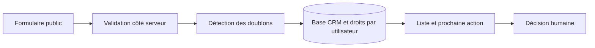

# Construire un CRM avec l’IA : architecture, sécurité et étapes pratiques

L’IA peut aider à écrire une interface, proposer un schéma ou expliquer un test. Elle ne remplace pas la définition des droits d’accès, la validation des données ni la vérification du résultat. Un premier CRM utile montre, pour chaque demande, qui en est responsable et quelle action doit suivre.

## Définir le processus avant les écrans

Dessinez le parcours d’une demande : réception, qualification, attribution, suivi, puis clôture. Définissez les statuts et les conditions pour changer de statut. Prévoyez aussi le doublon, la demande incomplète et le contact qui ne souhaite plus de suivi.

Utilisez des données fictives pendant la construction. Pour un prototype, trois ensembles suffisent souvent à illustrer le fonctionnement : contacts, demandes et activités. Un contact peut avoir plusieurs demandes ; une demande peut avoir plusieurs activités. Évitez de transformer chaque échange en une nouvelle fiche contact.

## Une architecture lisible

L’interface affiche la liste, le détail et la prochaine action. Une couche de validation vérifie les entrées. La base conserve les enregistrements et applique les permissions. Les intégrations importent ou transmettent uniquement les données nécessaires et autorisées.

Un exemple pédagogique de demande contient : `id`, `contact_id`, `source`, `status`, `owner_id`, `next_action_at` et `created_at`. Cette liste est un point de départ, pas un schéma universel. Un champ « source » décrit l’origine connue ; il ne doit pas transformer un simple clic en preuve de vente.

Ce schéma original décrit le prototype pédagogique ; il ne représente pas une architecture client déployée. Une requête rejetée par la validation ou les permissions ne doit pas atteindre l’enregistrement.

## Vérifier les permissions au niveau des données

Masquer un bouton ne protège pas un enregistrement. Un utilisateur peut tenter d’appeler directement une API. Le serveur ou la base doit vérifier l’identité et les droits pour chaque opération pertinente.

Avec Supabase et PostgreSQL, les politiques de sécurité au niveau des lignes peuvent limiter les accès. La [documentation RLS](https://supabase.com/docs/guides/database/postgres/row-level-security) explique leur mise en œuvre et les précautions concernant les clés privilégiées. Une clé donnant des privilèges serveur ne doit pas être incorporée au JavaScript public.

Écrivez au moins trois tests : le propriétaire peut lire sa demande ; un autre utilisateur ne peut pas la lire ; une requête non authentifiée est refusée. Ajoutez les tests d’écriture et de changement de propriétaire. Exécutez les tests avec les rôles réels du client, pas seulement avec un compte administrateur qui contourne les politiques.

## Faire travailler un outil IA sur des changements limités

Demandez d’abord un écran de liste avec des données fictives, puis un formulaire validé, puis la connexion à la base. Pour chaque étape, fournissez les critères d’acceptation et examinez les fichiers modifiés. Ne demandez pas un système complet avec « sécurité parfaite » comme unique spécification.

Gardez un journal des migrations. Testez une sauvegarde et une restauration avant d’utiliser de vraies données. Une automatisation doit gérer les doublons et les reprises : rejouer un événement ne devrait pas créer plusieurs demandes identiques.

## Un résultat à présenter avec ses limites

Le livrable est un prototype dont on peut démontrer les parcours et les contrôles. Il ne prouve pas une augmentation du chiffre d’affaires. Présentez les cas testés, les limites et les prochaines décisions.

Le [portfolio](/projets/) contient des démonstrations de systèmes de leads et CRM. Pour apprendre à construire, consultez [AI Development & Automation](/formations/developpement-ia-automatisation/). Pour faire cadrer et réaliser un CRM, passez par les [services](/services/).

*Auteur proposé : Elboubakry Abdessamad. Schéma et situations fictifs ; aucune donnée client n’est utilisée.*
