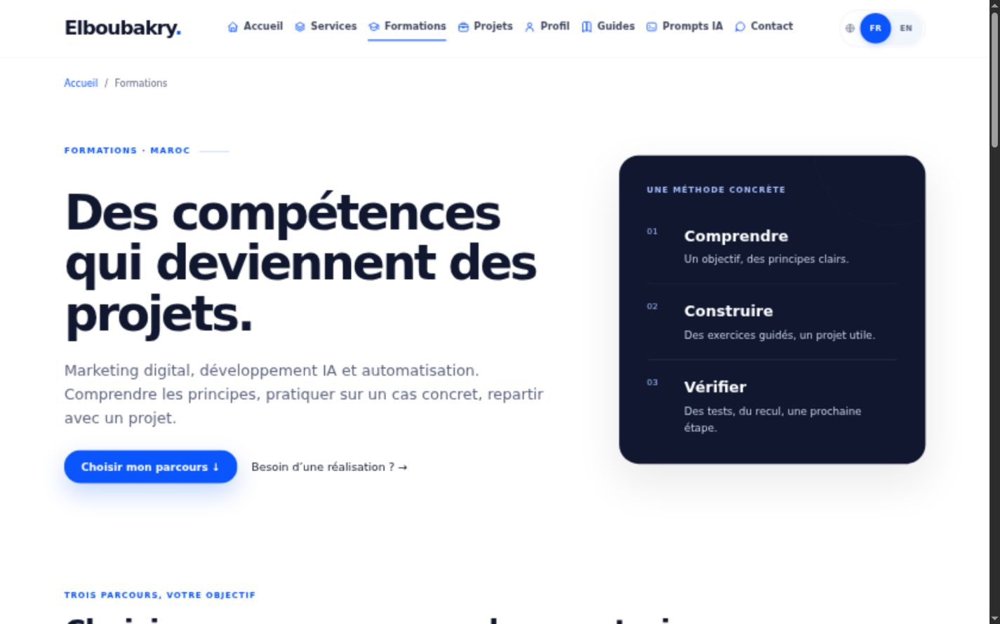

# Créer un site web avec Codex : du développement au déploiement Cloudflare

Pour créer un site avec un outil de développement assisté par IA, commencez par un brief testable et un dépôt identifiable. L’outil peut proposer des fichiers et des corrections ; vous devez encore vérifier le contenu, le fonctionnement et les conditions de publication. Le déploiement constitue une étape distincte de la génération du code.

## Un brief suffisamment concret

Décrivez le public, la décision attendue et les pages nécessaires. Ajoutez les contraintes : langues, identité visuelle, contenu approuvé, fonctionnement des formulaires, hébergement et règles de publication. Pour une refonte, listez les URLs à conserver et demandez une inspection du dépôt avant toute modification.

Un exemple de consigne utile : « Ajoute une page de formation avec public, prérequis, modules et contact. Réutilise les styles du site. Aucun tarif ou témoignage ne doit être inventé. Préserve les pages de services et vérifie les liens. Ne publie pas. » Le résultat est plus facile à évaluer qu’une demande de site « moderne et parfait ».

Consultez le [guide officiel de démarrage](https://learn.chatgpt.com/docs/quickstart) pour l’utilisation actuelle de Codex. Les interfaces et modes évoluent ; ce guide se concentre sur les livrables et les vérifications, sans supposer un bouton ou un abonnement particulier.

## Construire un premier parcours complet

Commencez par la navigation, une page représentative et son appel à l’action. Vérifiez le contenu dans le HTML, les libellés des champs, les états d’erreur et l’affichage mobile. Pour une page de présentation, une architecture statique peut suffire. Un formulaire connecté ou une zone authentifiée nécessite une conception supplémentaire.

Examinez les changements du dépôt. Vérifiez que les images sont autorisées, que les chemins sont corrects et qu’aucun secret n’est ajouté au code public. Une variable d’environnement n’est pas automatiquement secrète : certains outils injectent des valeurs dans le bundle client pendant la compilation.

## Vérifier avant de publier

Exécutez les commandes de contrôle réellement définies par le projet. Une commande appelée « build » peut générer les fichiers sans tester le comportement. Complétez-la avec une visite locale : navigation, liens, formulaire, mobile, clavier et absence de débordement horizontal.

Pour le référencement, contrôlez le titre, la description, le titre principal, la canonical, les directives robots et la présence dans le sitemap. Les liens de langue doivent relier des pages équivalentes réellement disponibles. Ne créez pas une version anglaise qui renvoie silencieusement vers une page française différente.

Un exemple de vérification terminal pour un projet qui définit ces scripts est `npm run build`, puis `npm test`. Ce ne sont pas des commandes universelles ; lisez le fichier de configuration du projet avant de les lancer.

*Capture de la version locale du projet Elboubakry, novembre 2026. Elle montre un écran construit et vérifié, sans attester d’une mise en production ou de résultats commerciaux.*

## Préparer Cloudflare avec un périmètre clair

Pour un site statique, [Cloudflare Pages](https://developers.cloudflare.com/pages/framework-guides/deploy-anything/) attend les fichiers publiables dans le répertoire de sortie configuré. Ce répertoire doit contenir uniquement les ressources publiques. Les brouillons éditoriaux, tests, sources privées et dépendances de développement n’ont pas à être servis aux visiteurs.

Déterminez si une publication est déclenchée automatiquement par un push. Faites valider la version à publier et les éventuels changements de configuration. Après une publication autorisée, vérifiez les URLs, les en-têtes, les ressources et le parcours de contact. Préparez le retour à la version précédente.

Pour apprendre ces étapes, consultez [AI Development & Automation](/formations/developpement-ia-automatisation/). Pour confier la réalisation ou une évolution de votre site, les [services web et IA](/services/) couvrent le cadrage et la mise en œuvre.

*Auteur proposé : Elboubakry Abdessamad. Tutoriel à reproduire avant publication ; aucune production n’a été modifiée pour rédiger ce texte.*
