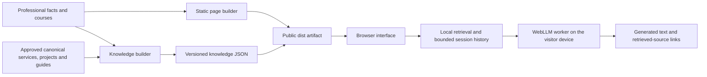

# Website upgrade delivery

> **Production update — 12 November 2026:** The owner subsequently authorized direct Cloudflare publication. Commit `eabff4f10d21f2cd6e8d3971bd4a83bc35744878` is now deployed to [elboubakry.com](https://elboubakry.com/) through Cloudflare Pages project `eawebsite`. [Deployment](https://2711bc5b.eawebsite.pages.dev): 58/58 live checks passed; project configuration and bindings were retained. [Evidence](cloudflare-deployment.json) records the previous deployment for rollback. GitHub remains unsynchronized because its authentication is blocked. The review-stage notes below describe the state before this later authorization. Real WebGPU generation testing remains pending.

12 November 2026. Implemented locally in **EAwebsite**, branch `codex/professional-training-knowledge`, based on `e64a68d4313604fae0eff9bb8b38a9eba7bb2016`. Prepared as a review branch for GitHub. No production deployment, real contact submission or paid inference request was performed. The review commit uses `[CF-Pages-Skip]` to suppress automatic Cloudflare Pages deployment.

The production-matching repository is `abdozonetech-byte/EAwebsite`. This upgrade preserves the existing operational features and keeps production deployment separate from the review branch.

## 1. Architecture changes

The existing static HTML/CSS/JavaScript architecture is retained. No framework migration or replacement of the CRM, forms, project pages or prompt library. New repeatable build scripts render professional identity and training, rebuild approved knowledge, bundle the local AI client and create a public-only `dist/` artifact. Existing Cloudflare Pages Functions stay in `functions/` and are compiled separately by the deployment platform.



Source responsibilities are documented in [CONTENT-MAINTENANCE.md](CONTENT-MAINTENANCE.md). The public package excludes drafts, source content, dependencies, tests and internal documentation. CI installs pinned dependencies and runs lint, typecheck, build/SEO and all test groups; it contains no deployment step.

## 2. Professional profile improvements

French positioning: **Consultant, Formateur & Développeur IA au Maroc**. English: **Consultant, Trainer & AI Developer in Morocco**. Homepage, profile, shared footer, guide signatures and Person structured data use the broader identity. Skills cover marketing, ads, SEO/GEO, Python/JavaScript, web, CRM, agents, automation, analytics, project management and teaching.

The existing 2018–2021 IT/web teaching background supports the instructor introduction. Existing professional history and credentials are retained; no experience, certification, customer result or student count was added. Original portrait files are unchanged. Existing consulting, projects, client references and diagnostic sections remain visible.

## 3. Training pages

| French route | English equivalent |
|---|---|
| `/formations/` | `/en/training/` |
| `/formations/marketing-digital-acquisition/` | `/en/training/marketing-digital-acquisition/` |
| `/formations/developpement-ia-automatisation/` | `/en/training/developpement-ia-automatisation/` |
| `/formations/ia-pour-entreprise/` | `/en/training/ia-pour-entreprise/` |

The existing blue, white and navy palette, typography and portrait are reused. Navigation includes Formations/Training, and the homepage has three compact programme cards. The overview includes the instructor, learning projects, FAQs and existing email/WhatsApp enquiry channels. No enquiry is sent automatically.

## 4. Course content structures

All three tracks include overview, audience, level, prerequisites, learning objectives, six modules with an exercise each, final outcome, instructor and contact action. The English pages contain complete adaptations. Duration, price, delivery arrangements, dates and certification are explicitly left for direct confirmation.

| Track | Six modules | Final learning project |
|---|---|---|
| Marketing Digital & Acquisition | Foundations/strategy; Meta and Google Ads; SEO/GEO; landing pages/conversion; analytics/KPIs; CRM/leads | Acquisition brief, campaign plans, landing page, measurement plan and demonstration pipeline |
| AI Development & Automation | AI foundations; Python/JavaScript; AI-assisted coding; agents/retrieval/workflows; APIs/web apps; testing/security/Cloudflare | Tested assistant or web-app prototype with sources, limitations and deployment instructions |
| AI for Business | Entrepreneur use cases; productivity/prompts; websites; CRM/automation; AI marketing; responsible AI/project | Business pilot with process, prototype, evaluation criteria and responsibilities |

These are pedagogical deliverables, not claims about client outcomes.

## 5. Insights audit

[INSIGHTS-AUDIT.md](INSIGHTS-AUDIT.md) contains a recommendation for each of the existing 30 guides, the baseline evidence, six clusters, overlap risks, weak internal links and verification priorities. Four guides have especially short treatment; all 30 lack primary-source links in their article bodies. Existing dates were preserved rather than refreshed artificially.

Potential keyword cannibalization is identified from content and intent overlap. It is not confirmed from traffic data: Search Console and backlink evidence were not available. No guide URL was removed or merged. All guide pages now have linked authorship and training/service next steps. The additional existing AI-business consulting guide is retained.

## 6. Article drafts and content plan

Six French manuscripts are in [content/drafts](../../content/drafts/). Four propose new educational articles. The SEO/GEO and lead-automation manuscripts are **updates to existing URLs**, avoiding competing articles. The audit links each manuscript and states its review requirements.

Each draft has `status: editorial_draft`, `publish: false`, a defined intention, primary references, practical examples and relevant training/service links. Technical tutorials require reproduction and author review. Drafts are absent from the public artifact, sitemap and AI index. No publishing cadence or unverified review date was imposed.

## 7. Technical SEO and GEO

The static audit passes for **488 HTML files, 480 sitemap URLs, 4,100 structured-data URL references and 565 redirect rules**. All 470 previous sitemap URLs remain. New pages have unique titles, descriptions, one H1, canonical URLs, appropriate robots directives, reciprocal FR/EN/x-default alternatives and visible breadcrumbs. Person, Course, WebPage and BreadcrumbList data match the new content. No invented offers, ratings or credentials appear in Course schema.

The 30 library cards and article text are rendered HTML. Filtering progressively hides cards without removing their source content from the initial document. Six subject entry points support discovery. Existing Article/BlogPosting and factual business markup are retained. The checks validate syntax, required project contracts, local references and visible course facts; they are not a claim of Google rich-result eligibility or indexing.

GEO work focuses on clear identity, authorship, definitions, contextual navigation and sources. There is no promise of ranking or inclusion in generated answers. [Google's AI-feature guidance](https://developers.google.com/search/docs/appearance/ai-features) and [Schema.org Course](https://schema.org/Course) informed the implementation.

## 8. AI and synchronized knowledge

The new public assistant is available at `/ai/` and `/en/ai/`. It identifies itself as a virtual assistant, not Abdessamad. It uses genuine WebLLM generation through a module worker with `Qwen2.5-1.5B-Instruct-q4f16_1-MLC`, or the q4f32 variant when shader-f16 is absent. The context window is 8,192 tokens; source text, history, user input and output are bounded.

The main interface is approximately 9.5 KB raw / 4.4 KB gzip. WebLLM is dynamically imported only after the visitor requests loading and a WebGPU adapter is available. Model artifacts come from Hugging Face/MLC; the interface discloses the download and memory requirement. This is local inference, not a fully offline first visit. No external inference API, paid AI API or telemetry is added to the assistant pages. Existing private CRM providers are outside this public assistant and were preserved.

The build creates **204 records** from approved profile/course facts and canonical services, project demonstrations and educational pages. Accent-normalized lexical retrieval distinguishes learning, hiring, profile, projects, reading and mixed intent, with bounded follow-up context. This is a lightweight retriever, not an embedding service or a trained intent model. It can misclassify unusual phrasing.

Retrieved routes are rendered as source links independently of generated prose. Model text is inserted as text, never executable HTML. Conversation history lives in tab memory and is cleared on reset/page exit; model files may remain in browser cache. Loading/generation can be cancelled, errors are explained, and unsupported browsers retain direct content links. A worker download guard permits only GET/HEAD to approved artifact origins. CSP adds WebAssembly compilation, same-origin workers and model-download origins without general `unsafe-eval`.

Official runtime references: [WebLLM basic usage](https://webllm.mlc.ai/docs/user/basic_usage.html), [WebLLM repository](https://github.com/mlc-ai/web-llm).

## 9. Tests and observed results

| Check | Result |
|---|---|
| `npm run lint` | Pass: authored JavaScript syntax and additive CSS sanity check; not a comprehensive style linter |
| `npm run typecheck` | Pass: strict TypeScript for the assistant |
| `npm run build` | Pass: content, knowledge, browser bundles, public packaging and static SEO/link audit |
| `npm test` | Pass: all 12 regression groups, including 23 upgrade tests; full output in [test-results.json](test-results.json) |
| Existing English and prompt generators | English regeneration exercised successfully; build hooks reapply managed content |
| Knowledge synchronization | A temporary approved-article edit changed the generated index; restoring the source reproduced the exact original index |
| Repeated content build | 491 checked outputs unchanged |
| Local HTTP checks | 57/57: existing guides, core/new pages, source-directory exclusions and protected preview route; [verification.json](verification.json) |
| Static accessibility | Labels, image alternatives/dimensions, main/skip links, control names and bilingual alternatives pass |
| Browser interaction | Mobile menu, course disclosure, FR/EN switch, Insights filter, AI suggestions/reset and unavailable-WebGPU state checked |
| Responsive inspection | 1440 px desktop, 390 px mobile, 320 px narrow mobile; corrected heading overflow; representative pages fit the viewport |
| Preservation | Original portrait files, Functions middleware and route configuration match baseline hashes; existing operational regression groups pass |

The test runner was corrected to fail on subprocess launch errors. Final suite runs used an environment permitting child processes and recorded actual output. The existing CRM import group skipped its workbook-specific check because the Casablanca source workbook is unavailable; its other tests pass. No live CRM provider calls, authentication flows or production form submissions were exercised.

Homepage HTML grew from 6,618 to 7,479 bytes gzip (about 0.9 KB). The additive stylesheet is approximately 2.9 KB gzip. The 6.1 MB raw WebLLM bundle and approximately 1 GB model download do not load on ordinary pages or before explicit AI loading. These are artifact measurements, not field Core Web Vitals. Screenshots: [training desktop](training-desktop.png), [training mobile](training-mobile.png), [homepage desktop](home-desktop.png).

## 10. Remaining limitations and release roadmap

1. **Real generated responses remain unverified.** The available browser reports WebGPU unavailable. The fallback is verified, but model loading, French/English generation quality, cancellation under load, latency and GPU memory require compatible hardware before release. The 23 automated checks validate retrieval and contracts, not generated answer quality. Use the [AI acceptance worksheet](AI-ACCEPTANCE.md).
2. Complete editorial review and reproduce tutorials before moving any draft to approved content. Verify commercial training arrangements directly; no values are inferred.
3. Run staging checks for Pages Functions, authentication, form delivery, real model artifact loading/CSP/cache and header/redirect behavior. The local preview is static and intentionally rejects protected APIs.
4. Measure Lighthouse/lab performance and field Core Web Vitals after an approved preview/release. Perform a full keyboard/screen-reader and cross-device audit; current accessibility checks are targeted rather than a WCAG certification.
5. Inspect Search Console query/page data before merging overlapping guides. Add distinct examples and primary references through reviewed revisions.
6. Production publication requires the owner's approval. For a future release, configure Cloudflare Pages to run `npm run build` with output `dist`, keeping the root Functions compilation and existing environment bindings. Verify an isolated preview first. Do not push to an auto-deploy branch before approval. Roll back both deployment and build/output settings together if necessary.

## Run locally

```sh
cd /home/abdozonetech/ChatGPT/Elboubakry/EAwebsite
npm ci
npm run build
npm run lint
npm run typecheck
npm test
npm run serve
```

The static preview uses `http://127.0.0.1:4173`. It does not execute Cloudflare Functions, contact submissions or CRM actions. Stop the preview with Ctrl-C when finished. The temporary review server is stopped at handover; screenshots and the built artifact remain available.
